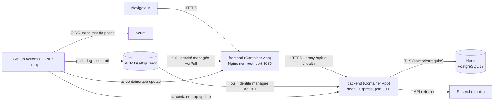

# Architecture cloud

## Choix

- Région `francecentral`, imposée par une politique d'abonnement (5 régions autorisées).
- Environnement Container Apps de type Express (créé par défaut) : pas de découverte de services entre apps, donc le backend est en ingress externe et le frontend l'appelle par son nom public, en HTTPS. Compromis de sécurité documenté dans `preuves/J4`.
- Images tirées de l'ACR avec une identité managée (rôle AcrPull) : aucun mot de passe de registre.
- Secrets (JWT, mot de passe admin, clé Resend, chaîne de connexion Neon) stockés comme secrets Azure, lus par le backend via `secretref`. Aucun dans le dépôt.
- CD authentifiée par OIDC avec une identité managée dédiée (`id-quiz-github-deploy`), limitée à la branche `main` du fork. Les droits : AcrPush sur l'ACR et Contributor sur le groupe `rg-quiz-app`. La création d'applications Entra est interdite sur le tenant, d'où l'identité managée.
- Base Neon : connexion directe (sans pooler), TLS obligatoire. Le schéma est créé une fois à la main avec `database/init.sql`.