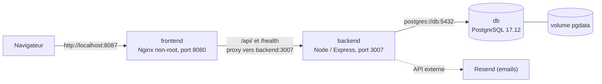

# Architecture locale

## Composants

| Composant | Rôle | Port |
|---|---|---|
| frontend | Nginx : sert le build Vite et fait proxy de `/api/` et `/health` vers le backend | 8080 dans le conteneur, 8087 sur l'hôte |
| backend | API Express : utilisateurs, résultats, administration (JWT) | 3007 (interne) |
| db | PostgreSQL, schéma créé par `database/init.sql` | 5432 (interne) |
| Resend | Envoi d'emails de résultats, service externe | HTTPS |

## Choix

- Le frontend appelle l'API en URL relative (`/api`), donc tout passe par Nginx et il n'y a pas d'URL de backend à injecter dans le build.
- Nginx est codé en dur sur `backend:3007` : le service Compose doit s'appeler `backend`.
- La base n'est pas exposée sur l'hôte. Seul le backend la joint, par le nom `db`.
- Les données sont dans le volume nommé `pgdata`, qui survit à la suppression des conteneurs.
- Le frontend est construit en deux étapes (Node pour `vite build`, puis Nginx avec seulement `dist/`). Les images frontend et backend tournent sans root.
- `database/nginx/nginx.conf` est un doublon de `nginx/nginx.conf` : il n'est pas utilisé.